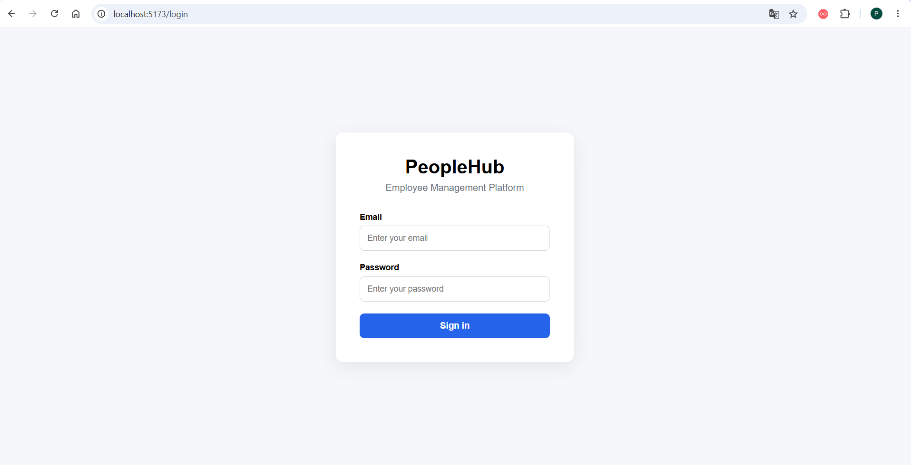
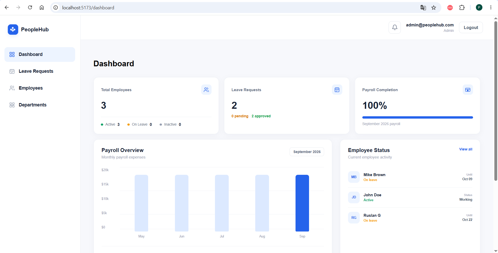
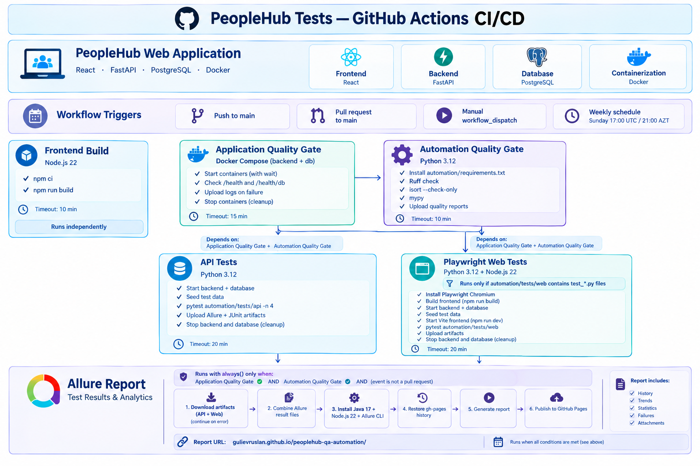

# PeopleHub — QA Automation

**A full-stack HR management application with automated API and UI testing, CI/CD integration, and centralized test reporting.**

PeopleHub is a portfolio project demonstrating practical QA Automation Engineering through business-critical workflow validation, API and browser automation, code quality checks, and continuous integration.

[](https://www.python.org/)
[](https://docs.pytest.org/)
[](https://playwright.dev/)
[](https://docs.github.com/en/actions)
[](https://docs.docker.com/)

[](https://gulievruslan.github.io/peoplehub-qa-automation/)
[](https://qase.io/)

## Table of Contents

- [Project Overview](#project-overview)
- [Application Preview](#application-preview)
- [System Architecture](#system-architecture)
- [QA Automation Tech Stack](#qa-automation-tech-stack)
- [Automated Testing](#automated-testing)
- [Test Management](#test-management)
- [CI/CD and Reporting](#cicd-and-reporting)
- [Application Technology Stack](#application-technology-stack)
- [Running Locally](#running-locally)
- [Project Focus](#project-focus)

## Project Overview

PeopleHub is an HR management application designed to provide a realistic environment for testing common business workflows.

### Key Features

- **Employee Management** — employee profiles and employment status.
- **Department Management** — department creation and maintenance.
- **Role-Based Access Control (RBAC)** — role-dependent permissions for administrators, HR managers, and employees.
- **Leave Management** — leave request workflows.
- **Payroll** — payroll information and employee records.
- **Dashboard** — an overview of key HR metrics.
- **Authentication** — login and protected application access.

## Application Preview

### Sign In

<p align="center">
  
</p>

### Dashboard

<p align="center">
  
</p>

## System Architecture

The diagram illustrates the PeopleHub application architecture, technology stack, automated testing layers, and CI/CD workflow.

<p align="center">
  
</p>

## QA Automation Tech Stack

### Core & API Automation

[](https://www.python.org/)
[](https://docs.pytest.org/)
[](https://requests.readthedocs.io/)
[](https://docs.pydantic.dev/)

### Web Automation

[](https://playwright.dev/)

### Code Quality

[](https://docs.astral.sh/ruff/)
[](https://pycqa.github.io/isort/)
[](https://mypy.readthedocs.io/)

### CI/CD & Infrastructure

[](https://docs.github.com/en/actions)
[](https://docs.docker.com/)

### Test Reporting & Management

[](https://allurereport.org/)
[](https://qase.io/)

## Automated Testing

The automation suite covers backend functionality and user-facing workflows.

<details>
<summary><strong>Current Automation Coverage</strong></summary>

| Test Layer | Automated Tests | Focus |
|:-----------|----------------:|:------|
| API | 32 | Endpoints, response data, business rules, and access control |
| Web | 33 | Browser-based user workflows using Playwright |
| **Total** | **65** | **API and UI automation** |

The API suite currently provides the larger share of automation coverage. Web automation is actively being expanded.

</details>

### API Testing

- Automated verification of backend endpoints and application behavior.
- Validation of response status codes and data structures.
- Coverage of key business rules and role-based access permissions.
- Reusable test components and structured test data.

### Web Testing

- End-to-end browser automation with Playwright and Pytest.
- Verification of key user workflows through the application interface.
- Checks for authentication, navigation, and role-dependent behavior.
- Failure artifacts to support UI test investigation.

## Test Management

Test cases are managed in Qase, providing a structured repository for test documentation and coverage.

**[View PeopleHub Test Cases in Qase](https://app.qase.io/project/PEOPLEHUB?suite=30)**

The project connects test management with automated execution and reporting, helping maintain traceability between documented scenarios and automated checks.

## CI/CD and Reporting

GitHub Actions runs automated quality checks, API tests, and browser tests in a repeatable CI environment.

### Pipeline Workflow

1. **Frontend Build** — installs frontend dependencies and verifies that the application builds successfully.
2. **Application Quality Gate** — starts the backend and PostgreSQL services in Docker and verifies application health.
3. **Automation Quality Gate** — runs Ruff, isort, and mypy checks.
4. **API Tests** — executes the API automation suite using Pytest with parallel execution.
5. **Playwright Tests** — runs browser-based tests against the application.
6. **Allure Report** — combines available test results, generates the report, and publishes it to GitHub Pages when the required quality gates succeed.

The workflow supports pushes and pull requests targeting `main`, manual execution, and scheduled runs.

### Allure Report

**[Open the Latest Allure Report](https://gulievruslan.github.io/peoplehub-qa-automation/)**

The report provides visibility into test execution results, individual test cases, execution statuses, and failure details. It is published to a persistent URL when a new report is successfully generated and deployed.

### GitHub Actions

**[View CI Pipeline Runs](https://github.com/gulievruslan/peoplehub-qa-automation/actions)**

The Actions page provides access to workflow runs, job statuses, execution logs, and uploaded test artifacts.

## Application Technology Stack

| Area | Technologies |
|:-----|:-------------|
| Backend | Python, FastAPI |
| Frontend | React, JavaScript, Vite |
| Database | PostgreSQL, SQL, Alembic |
| API Automation | Pytest, Requests, Pydantic |
| UI Automation | Playwright, Pytest |
| Infrastructure | Docker, Docker Compose |
| CI/CD | GitHub Actions |
| Reporting | Allure |
| Test Management | Qase |
| Code Quality | Ruff, isort, mypy |

## Running Locally

### 1. Start the Backend and Database

From the repository root:

```bash
docker compose up --build -d --wait
```

### 2. Prepare the Database and Test Data

```bash
docker compose exec -T backend python -m app.seed
```

### 3. Start the Frontend

Open a separate terminal and navigate to the frontend directory:

```bash
cd app/frontend
npm install
npm run dev
```

### 4. Install Automation Dependencies

From the repository root, create and activate a Python virtual environment if needed, then install the project dependencies:

```bash
python -m venv .venv
```

Activate the environment on Windows:

```powershell
.venv\Scripts\Activate.ps1
```

Install the automation dependencies:

```bash
python -m pip install -r automation/requirements.txt
```

### 5. Run Automated Tests

Run the API tests:

```bash
python -m pytest automation/tests/api
```

Run the Web tests:

```bash
python -m pytest automation/tests/web
```

Refer to the repository configuration for required environment variables, application URLs, and additional test execution options.

## Project Focus

PeopleHub demonstrates a practical approach to quality engineering:

- Building maintainable API and browser automation.
- Validating business rules and role-based access.
- Integrating automated testing into CI/CD.
- Enforcing code quality through automated checks.
- Connecting test management, execution, and reporting.
- Making test results accessible and useful for investigation.

The emphasis is on building a repeatable quality workflow that can grow alongside the application, rather than simply accumulating test scripts.

---

**Ruslan Guliev**
QA Automation Engineer | Python · Pytest · Playwright · API Testing · CI/CD

[GitHub Repository](https://github.com/gulievruslan/peoplehub-qa-automation)